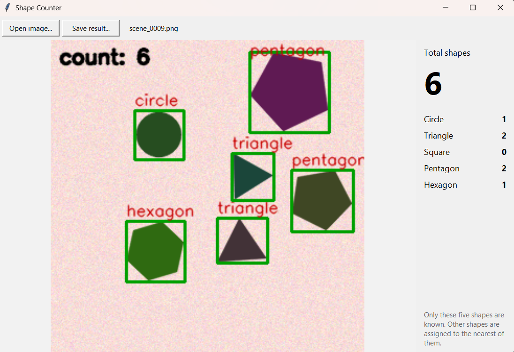

# Shape Counter

A small Windows desktop app that finds, classifies and counts simple geometric shapes (circle, triangle, square, pentagon, hexagon) in an image.

Open an image, and the app draws a box and label around every shape and shows the total and the count per shape.



## Download and run

1. Go to the **Releases** page of this repository and download `ShapeCounter.zip`.
2. Unzip the whole folder anywhere (do not move `ShapeCounter.exe` out of it).
3. Double-click `ShapeCounter.exe`. No Python installation is needed.

Windows SmartScreen may show an "unknown publisher" warning because the file is not code-signed. Click **More info** and then **Run anyway**.

## Using the app

- **Open image...** (or double-click the empty window) to choose a picture. PNG, JPG, BMP, TIFF and WebP files work; transparent PNGs are placed on a white background.
- The annotated result appears in the window, with the total number of shapes and the count for each shape on the right.
- **Save result...** saves the annotated picture as a PNG.
- Large images are scaled down to 1000 pixels on the longest side before analysis.

It works best on flat-coloured shapes on a plain background, such as drawings, slides and screenshots. Shapes may touch or overlap a little.

## What it can and cannot do

- It knows **five shapes only**. Any other shape is assigned to the nearest of them (for example a rectangle is reported as a square).
- Shadows, gradients, textured or patterned backgrounds and strong perspective are not handled. The method was developed and tested on generated images and clean Kaggle shape datasets, not on real photographs.
- Very small shapes (about 30 pixels wide or less) are found, but their corners are coarse, so their labels can be wrong.
- Heavily overlapping shapes are separated most of the time, but a small shape lying on a large one can stay merged, and a partly hidden shape can get the wrong label.

## How it works

1. **Mask.** The background colour is estimated from the image border. Every pixel is compared with it by colour distance, and a threshold (Otsu, lowered so that pale shapes are not missed) gives a black-and-white mask.
2. **Contours.** Every connected region above a minimum size is one candidate shape.
3. **Splitting.** Regions that are not convex (touching or overlapping shapes) are split with a distance transform and a watershed, using scipy.
4. **Features.** Each shape is cropped, centred and resized to a 64x64 silhouette, and five numbers are measured from its outline: number of corners, fill ratio of its enclosing circle, fill ratio of its enclosing rectangle, rectangle aspect ratio, and the first Hu moment.
5. **Classifier.** A Random Forest trained on 4,150 shape images predicts the class from these five numbers.

In the original course evaluation (a test set of 830 images and training on two data sources while testing on the third), classification accuracy was 1.000 and 0.9989 or better, and clean multi-shape scenes were counted exactly in every case. See the course project for the data, the full evaluation and the limits of those numbers:

**Course project repository:** https://github.com/ArghaPatra/Object-Identification

## Run from source

Requires Python 3.11 or newer (the standard Windows installer includes Tkinter).

```bash
pip install numpy pandas scipy scikit-learn opencv-python-headless joblib
python train_model.py     # trains the model once and saves models/shape_rf.joblib
python app.py
```

`train_model.py` reads the measured features of the training images from `data/processed/features.csv`, which is included in this repository.

## Build the .exe yourself

```bash
pip install pyinstaller
build_exe.bat
```

The app is created in `dist\ShapeCounter\ShapeCounter.exe`. Zip the whole `dist\ShapeCounter` folder to share it. Expect a large folder (several hundred MB) because numpy, scipy, scikit-learn and OpenCV are bundled.

If PyInstaller crashes while importing packages, build from a clean environment that has only the packages listed above plus `pyinstaller`. Environments that also contain PyTorch or scikit-image can cause crashes. If the Windows build runs but the window does not open, remove the `--windowed` option in `build_exe.bat`, rebuild and start the exe from a Command Prompt to see the error message.

## Troubleshooting

- **A message box with an error:** the details are also written to `shape_counter_error.log` in your user folder.
- **"Model file not found":** run `python train_model.py` first (from source), or use the release zip, which contains the model.
- **Nothing is detected:** the shapes may be too similar in colour to the background, or too small. Try a larger or higher-contrast image.

## Files

```
app.py                  the window (Tkinter)
train_model.py          trains and saves the Random Forest
build_exe.bat           builds the Windows executable with PyInstaller
src/preprocess.py       background-colour mask
src/features.py         the shape measurements
src/counting.py         contour detection, splitting, drawing
data/processed/features.csv   measured features of the training images
```

## Credits

Author: Argha Patra.

The detection and classification method comes from a team course project for IDC409 (Object Identification); see the course repository linked above. The Kaggle datasets used there are credited in that repository.